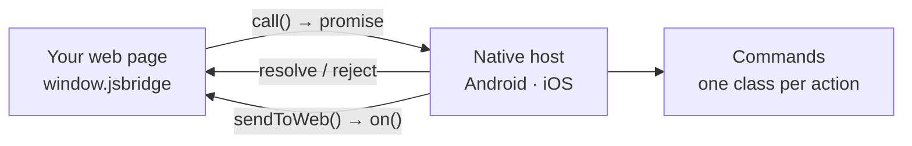

<h1 align="center">jsbridge</h1>

<p align="center">
  One promise-based JavaScript API for web pages inside Android and iOS apps.<br>
  Write <code>await jsbridge.call('deviceInfo')</code> once. Skip the platform <code>if</code> statements.
</p>

<p align="center">
  <a href="https://github.com/kibotu/jsbridge/actions/workflows/android.yml"></a>
  <a href="https://github.com/kibotu/jsbridge/actions/workflows/ios.yml"></a>
  <a href="https://github.com/kibotu/jsbridge/actions/workflows/web.yml"></a>
  <a href="https://central.sonatype.com/artifact/net.kibotu/jsbridge"></a>
  <a href="https://jitpack.io/#kibotu/jsbridge"></a>
  <a href="https://github.com/kibotu/jsbridge/tags"></a>
</p>

<p align="center">
  <a href="https://kibotu.github.io/jsbridge/">Live demo</a> ·
  <a href="#for-web-developers">Web</a> ·
  <a href="#for-app-developers">Android &amp; iOS</a> ·
  <a href="https://medium.com/proandroiddev/one-await-to-rule-them-all-a-unified-webview-bridge-for-android-and-ios-6e4aa9f9f683">Article</a> ·
  <a href="CHANGELOG.md">Changelog</a>
</p>

<p align="center">
  <a href="https://medium.com/proandroiddev/one-await-to-rule-them-all-a-unified-webview-bridge-for-android-and-ios-6e4aa9f9f683">
    
  </a>
  <br>
  <sub>Want the story behind jsbridge? Read <a href="https://medium.com/proandroiddev/one-await-to-rule-them-all-a-unified-webview-bridge-for-android-and-ios-6e4aa9f9f683"><em>One await to rule them all</em></a> on ProAndroidDev.</sub>
</p>

---

## Why jsbridge?

A WebView in a native app has no common way to talk to its host. Android gives you [`@JavascriptInterface`][android-js-interface]. iOS gives you [`WKScriptMessageHandler`][ios-script-handler]. The two APIs differ in transport, data types and callbacks.

Without jsbridge, every feature needs code like this:

```js
function getDeviceInfo(done) {
  if (window.AndroidBridge) {
    const cb = 'onDeviceInfo_' + Date.now();
    window[cb] = (json) => { delete window[cb]; done(JSON.parse(json)); };
    window.AndroidBridge.getDeviceInfo(cb);
  } else if (window.webkit?.messageHandlers?.nativeBridge) {
    window.onDeviceInfoResult = done;
    window.webkit.messageHandlers.nativeBridge.postMessage({
      action: 'getDeviceInfo', callbackName: 'onDeviceInfoResult'
    });
  } else {
    done({ platform: 'desktop' });
  }
}
```

With jsbridge:

```js
const info = await jsbridge.call('deviceInfo');
```

- **One API, both platforms.** `bridge.js` is the single source of truth. Android and iOS inject the same file.
- **Promises, not callbacks.** Use `async`/`await`. Nothing pollutes `window`.
- **Feature detection, not version checks.** Ask `jsbridge.supports('haptic.pattern')`. Do not parse app versions.
- **Batteries included.** Toasts, alerts, haptics, secure storage, safe area, system bars and more.
- **Easy to extend.** A new native command is about 15 lines. See [Add a command](#add-a-command).
- **Easy to test.** In a desktop browser, a mock handler replaces native.

<p align="center">
  
</p>

## How it works



1. Your page calls `jsbridge.call(action, content)`. The call returns a promise.
2. `bridge.js` sends a message to the host through the platform channel.
3. The host runs the command that matches `action`. It answers with `{ id, data }` or `{ id, error }`.
4. `bridge.js` resolves or rejects the promise.

The host can also push messages to the page. Register a handler with `jsbridge.on()`.

---

## For web developers

Your page needs no SDK and no build step. The host app injects `window.jsbridge` before your scripts run.

### Try it

1. Open the [live demo](https://kibotu.github.io/jsbridge/) in any browser. It uses the desktop mock.
2. Or open [`index.html`](index.html) from this repository.
3. To see the real thing, run a [sample app](#build-and-test) and open the same page in its WebView.

### Quick start

```js
await jsbridge.ready();                       // 1. Wait for the bridge.

const info = await jsbridge.call('deviceInfo'); // 2. Ask native.
console.log(info.platform, info.model);

jsbridge.on(({ data: { action, content } }) => { // 3. Listen to native.
  if (action === 'lifecycle' && content.event === 'focused') refreshData();
});
```

That is the whole API: `call` sends, `on` listens. Everything else is an `action` string.

### API

| Member | Description |
|--------|-------------|
| `jsbridge.ready()` | Resolves when the bridge is initialized. Call it first. |
| `jsbridge.call(action, content?, opts?)` | Sends a request to native. Returns a promise. `opts.timeout` defaults to 30 000 ms. |
| `jsbridge.on(fn)` / `jsbridge.off(fn)` | Adds or removes a handler for native-to-web messages. Several handlers can exist. |
| `jsbridge.supports(feature)` | Returns `true` if the host implements `feature`. Synchronous and always safe. |
| `jsbridge.features` | Frozen array of all features the host declared. |
| `jsbridge.platform` | `'android'`, `'ios'` or `'desktop'`. |
| `jsbridge.cancelAll()` | Rejects all pending promises. Use it when a screen closes. |
| `jsbridge.setDebug(bool)` | Logs every message to the console. |
| `jsbridge.setMockHandler(fn, { features }?)` | Replaces native in a desktop browser. See [Test without a device](#test-without-a-device). |
| `jsbridge.getStats()` | Returns `{ pendingRequests, platform, features, handlers, debugEnabled }`. |

`call()` also accepts a full message, `call({ data: { action, content } }, opts)`, for older pages.

### Built-in actions

All actions work on Android and iOS. Pass `DefaultCommands.all()` on the native side to enable them.

| Area | Actions | Notes |
|------|---------|-------|
| Device | `deviceInfo`, `networkState`, `openSettings`, `requestPermissions` | Platform, OS, model, connectivity, settings screen, runtime permissions. |
| UI | `showToast`, `showAlert`, `haptic`, `copyToClipboard` | Native versions of things the web does poorly. |
| Chrome | `topNavigation`, `bottomNavigation`, `systemBars` | Your page controls the native bars. `systemNavigation` exists on Android only. |
| Layout | `insets`, `systemBarsInfo` | Safe area, keyboard and bar sizes in dp (Android) or pt (iOS). |
| Navigation | `navigation` | Open a URL in the app or in the browser. Go back. |
| Storage | `saveSecureData`, `loadSecureData`, `removeSecureData` | [Keychain][ios-keychain] on iOS. Encrypted storage on Android. |
| Analytics | `trackEvent`, `trackScreen` | Fire and forget. Do not `await`. |
| App | `refresh`, `themeChanged` | Ask the host to refresh data or relay a theme choice. The host app decides what to do. |
| Events | `lifecycle` (native → web) | See [Know when your page is visible](#know-when-your-page-is-visible). |

Examples:

```js
await jsbridge.call('showToast', { message: 'Saved', duration: 'short' });
await jsbridge.call('showAlert', { title: 'Delete?', message: 'This cannot be undone.', buttons: ['Delete', 'Cancel'] });
await jsbridge.call('topNavigation', { isVisible: true, title: 'Home', showUpArrow: false });
await jsbridge.call('systemBars', { showStatusBar: false, showSystemNavigation: false });
await jsbridge.call('navigation', { url: 'https://example.com', external: true });

await jsbridge.call('saveSecureData', { key: 'token', value: 'abc123' });
const { value } = await jsbridge.call('loadSecureData', { key: 'token' });

jsbridge.call('trackEvent', { event: 'button_click', params: { screen: 'home' } }); // no await
```

### Layout under system bars

Native pushes the safe area to your page as [CSS custom properties][mdn-custom-properties]. This happens when bars change, the device rotates or the keyboard opens. You do not call anything.

```css
body {
  padding-top: var(--bridge-inset-top, env(safe-area-inset-top, 0px));
  padding-bottom: var(--bridge-inset-bottom, env(safe-area-inset-bottom, 0px));
}
```

The fallback chain is the bridge value, then [`env()`][mdn-env], then `0px`. The same CSS works in the app and in a normal browser.

| Property | Meaning |
|----------|---------|
| `--bridge-inset-top` / `-bottom` | Combined inset: status bar and top navigation, or system navigation and bottom navigation. |
| `--bridge-inset-left` / `-right` | Side insets for landscape and foldables. |
| `--bridge-status-bar` | Status bar height. |
| `--bridge-top-nav` / `--bridge-bottom-nav` | Native top bar and bottom tab bar heights. |
| `--bridge-system-nav` | System navigation bar height (Android). |

When you hide the native top bar, `--bridge-inset-top` grows to cover the status bar. When you show it again, the value shrinks. You do not track this yourself.

Need the numbers in JavaScript, for example for a canvas? Query them:

```js
const { safeArea, statusBar, keyboard } = await jsbridge.call('insets');
const bars = await jsbridge.call('systemBarsInfo'); // { statusBar: { height, isVisible }, ... }
```

<table>
  <tr>
    <th>Android</th>
    <th>iOS</th>
  </tr>
  <tr>
    <td></td>
    <td></td>
  </tr>
</table>

### Know when your page is visible

A WebView does not always know when it is covered. A bottom sheet, a modal, a native tab switch or a pushed screen hides your page. The browser fires no [`visibilitychange`][mdn-visibility] event in these cases.

The host tells you instead:

```js
jsbridge.on(({ data: { action, content } }) => {
  if (action !== 'lifecycle') return;
  if (content.event === 'focused') { refreshData(); resumeAnimations(); }
  if (content.event === 'defocused') { pauseAnimations(); }
});
```

On `focused`, native also pushes the safe area again. Your layout stays correct after you return from another screen. Register `on()` once at startup and route by `action`.

### Detect features, not versions

There is no protocol version. The host declares what it can do. Your page checks for the one thing it needs.

```js
if (jsbridge.supports('haptic.pattern')) {
  await jsbridge.call('haptic', { type: 'pattern', timings: [0, 40, 80], amplitudes: [1, 0, 1] });
} else {
  await jsbridge.call('haptic', { vibrate: true });
}
```

- Each command declares its action name, for example `haptic`. A command that grows declares finer names, for example `haptic.pattern`.
- A changed capability gets a **new name**. Names never contain numbers.
- Unknown names, `null` and non-strings return `false`.
- Calling an unknown action rejects with `UNKNOWN_ACTION`. A missing check fails loudly.
- Run `jsbridge.features` in the console to see everything the host offers.

### Handle errors

```js
try {
  await jsbridge.call('deviceInfo', null, { timeout: 5000 });
} catch (e) {
  if (e.message.includes('timeout')) console.warn('Native did not answer in time');
  else console.error(e.code, e.message); // for example INVALID_PARAMETER
}
```

Every error has `.code` and `.message`.

### Test without a device

In a desktop browser, `jsbridge.platform` is `'desktop'` and no feature is supported. Register a mock to develop without an app:

```js
jsbridge.setMockHandler(
  ({ data: { action } }) => {
    if (action === 'deviceInfo') return { platform: 'desktop', model: 'Chrome' };
    if (action === 'networkState') return { connected: true, type: 'wifi' };
    return {};
  },
  { features: ['deviceInfo', 'networkState'] }
);
```

### Debug on a device

| Platform | Steps |
|----------|-------|
| Android | Enable USB debugging. Open `chrome://inspect`. Click **Inspect** under your WebView. See [Remote debug WebViews][chrome-webview-debug]. |
| iOS | Enable **Settings → Safari → Advanced → Web Inspector**. In Safari on your Mac, open **Develop → your device → your WebView**. See [Inspecting iOS][safari-inspect]. |

Then try this in the console:

```js
jsbridge.setDebug(true);          // log every message
await jsbridge.call('deviceInfo');
jsbridge.getStats();              // find stuck promises: { pendingRequests: 0, ... }
```

### TypeScript

```ts
interface CallOptions { timeout?: number }
type Message = { data: { action: string; content?: unknown } };

interface Bridge {
  readonly features: readonly string[];
  readonly platform: 'android' | 'ios' | 'desktop';
  ready(): Promise<void>;
  supports(feature: string): boolean;
  call<T = unknown>(action: string, content?: unknown, opts?: CallOptions): Promise<T>;
  call<T = unknown>(msg: Message, opts?: CallOptions): Promise<T>;
  on(handler: (msg: Message) => void): void;
  off(handler: (msg: Message) => void): void;
  cancelAll(): void;
  setDebug(enabled: boolean): void;
  setMockHandler(handler: ((msg: Message) => unknown) | null, opts?: { features?: string[] }): void;
  getStats(): { pendingRequests: number; platform: string; features: readonly string[]; handlers: number; debugEnabled: boolean };
}

declare global { interface Window { jsbridge: Bridge } }
```

### Good habits

- Call `await jsbridge.ready()` first.
- Set a `timeout` on calls that matter. Five seconds is plenty.
- Do not `await` analytics. Do not wait for what you do not need.
- Cache `deviceInfo`. It does not change during a session.
- Run independent calls in parallel with [`Promise.all()`][mdn-promise-all].
- Call `cancelAll()` when a screen closes.

---

## For app developers

You add the library, hand it your WebView and pick the commands you want. Each platform has a full guide:

|  | Library | Guide | Requirements |
|--|---------|-------|--------------|
| **Android** | `net.kibotu:jsbridge` (Kotlin) | [`android/README.md`](android/README.md) | API 24+ |
| **iOS** | `JSBridge` (Swift package) | [`ios/README.md`](ios/README.md) | iOS 16+, Swift 6, Xcode 16 |

### Android

```kotlin
// build.gradle.kts
dependencies {
    implementation("net.kibotu:jsbridge:<version>") // see the Maven Central badge
}
```

```kotlin
val bridge = JavaScriptBridge.inject(
    webView = webView,
    commands = DefaultCommands.all()
)
```

The library also ships on [JitPack](https://jitpack.io/#kibotu/jsbridge). Secure storage needs an extra dependency. See [Secure storage](android/README.md#secure-storage).

### iOS

Add the package in Xcode (**File → Add Package Dependencies…**) or in `Package.swift`:

```swift
.package(url: "https://github.com/kibotu/jsbridge", from: "1.0.0")
// then: .product(name: "JSBridge", package: "jsbridge")
```

```swift
import JSBridge

let bridge = JavaScriptBridge(
    webView: webView,
    viewController: self,
    commands: DefaultCommands.all()
)
```

### Pick your commands

`DefaultCommands.all()` enables everything. To expose less, list the commands you want:

```kotlin
// Android
commands = listOf(DeviceInfoCommand(), ShowToastCommand(), HapticCommand())
```

```swift
// iOS
commands: [DeviceInfoCommand(), ShowToastCommand(), HapticCommand()]
```

An action without a command rejects with `UNKNOWN_ACTION`. The page can see what exists in `jsbridge.features`.

### Send events to the page

```kotlin
bridge.sendToWeb(action = "lifecycle", content = mapOf("event" to "focused"))   // Android
```

```swift
bridge.sendToWeb(action: "lifecycle", content: ["event": "focused"])            // iOS
```

### Send focus events

Tell the page when it becomes visible or hidden. Push the safe area again on focus.

```kotlin
// Android: Activity or Fragment
override fun onWindowFocusChanged(hasFocus: Boolean) {
    super.onWindowFocusChanged(hasFocus)
    bridge.sendToWeb("lifecycle", mapOf("event" to if (hasFocus) "focused" else "defocused"))
    if (hasFocus) SafeAreaService.pushTobridge(bridge)
}
```

```swift
// iOS: UIViewController
func onWindowFocusChanged(hasFocus: Bool) {
    bridge.sendToWeb(action: "lifecycle", content: ["event": hasFocus ? "focused" : "defocused"])
    if hasFocus { SafeAreaService.shared.pushToBridge(bridge) }
}
```

On iOS, the `WindowFocusObserver` protocol detects modals, tab switches and app backgrounding for you. The [sample app](ios/BridgeSample) shows how.

### Add a command

A command is one class. You do not touch bridge code.

**1. Write it.**

```kotlin
// Android
class GreetCommand : BridgeCommand {
    override val action = "greet"
    override suspend fun handle(content: Any?): Any? {
        val name = BridgeParsingUtils.parseString(content, "name") ?: "world"
        return JSONObject().put("greeting", "hello, $name")
    }
}
```

```swift
// iOS
class GreetCommand: BridgeCommand {
    let action = "greet"
    func handle(content: [String: Any]?) async throws -> [String: Any]? {
        ["greeting": "hello, \(content?["name"] as? String ?? "world")"]
    }
}
```

**2. Register it.**

```kotlin
commands = DefaultCommands.all() + GreetCommand()      // Android
```

```swift
commands: DefaultCommands.all() + [GreetCommand()]     // iOS
```

**3. Call it.**

```js
const { greeting } = await jsbridge.call('greet', { name: 'Ada' });
```

To declare finer features, override `features` in your command. For example, return `setOf("greet", "greet.formal")`. Return `null` from `handle` for fire and forget.

### Several bridges, custom names

One WebView can host several bridges. Each bridge has its own global name and command set. A different name also avoids a clash with other scripts.

```kotlin
// Android
JavaScriptBridge.inject(webView, bridgeName = "jsbridge",  commands = DefaultCommands.all())
JavaScriptBridge.inject(webView, bridgeName = "analytics", commands = listOf(TrackEventCommand(), TrackScreenCommand()))
```

```swift
// iOS
JavaScriptBridge(webView: webView, viewController: self, bridgeName: "jsbridge",  commands: DefaultCommands.all())
JavaScriptBridge(webView: webView, viewController: self, bridgeName: "analytics", commands: [TrackEventCommand(), TrackScreenCommand()])
```

```js
await jsbridge.call('deviceInfo');
await analytics.call('trackEvent', { event: 'click' });
```

### Message format

Both platforms use the same JSON:

```jsonc
// web → native
{ "id": "msg_1234567890_1_abc123xyz", "data": { "action": "showToast", "content": { "message": "Hello!" } } }

// native → web: success, or failure
{ "id": "msg_1234567890_1_abc123xyz", "data": { } }
{ "id": "msg_1234567890_1_abc123xyz", "error": { "code": "INVALID_PARAMETER", "message": "…" } }
```

An `error` field rejects the promise. Messages carry no version number.

### Security

- `window.jsbridge` is [frozen][mdn-freeze]. Page scripts cannot replace it.
- Android exposes only methods marked `@JavascriptInterface`. Those methods run on a background thread. The library moves WebView work to the main thread.
- iOS registers one named `WKScriptMessageHandler`.
- Commands validate their input.
- **Load only content you trust.** Any script in the WebView can call every command you register. Register only the commands the page needs. Review the [Android WebView security tips][android-webview-security].

---

## Contribute

### Project layout

```text
jsbridge/
├── bridge.js        # The shared JavaScript. Single source of truth.
├── index.html       # Demo page. Both sample apps load it.
├── android/
│   ├── jsbridge/    # Library (net.kibotu.jsbridge)
│   └── sample/      # Sample app
├── ios/
│   ├── JSBridge/    # Swift package
│   └── BridgeSample # Sample app
├── test/            # JavaScript tests
├── .maestro/        # UI flows for the Android sample
└── docs/            # Images for this README
```

### Build and test

| Task | Command |
|------|---------|
| Run the Android sample | Open `android/` in Android Studio. Run `:sample`. |
| Run the iOS sample | Open `ios/BridgeSample.xcodeproj` in Xcode. Press <kbd>Cmd</kbd>+<kbd>R</kbd>. |
| Test JavaScript | `npm test` |
| Test Android | `cd android && ./gradlew :jsbridge:testDebugUnitTest` |
| Test iOS | `cd ios/JSBridge && swift test` |
| UI flows (Android) | `maestro test .maestro/` with [Maestro](https://maestro.mobile.dev/) |

Android needs JDK 21 to build from source.

### Changes

Release notes live in the [changelog](CHANGELOG.md).

## Support

If jsbridge saved you a few hours, or a few `if` statements, you can [buy me a coffee](https://buymeacoffee.com/kibotu). Questions and ideas are welcome in [issues](https://github.com/kibotu/jsbridge/issues).

## License

[Apache License 2.0](LICENSE).

<!-- References -->
[android-js-interface]: https://developer.android.com/reference/android/webkit/JavascriptInterface
[android-webview-security]: https://developer.android.com/privacy-and-security/risks/insecure-webview-native-bridges
[ios-script-handler]: https://developer.apple.com/documentation/webkit/wkscriptmessagehandler
[ios-keychain]: https://developer.apple.com/documentation/security/keychain-services
[chrome-webview-debug]: https://developer.chrome.com/docs/devtools/remote-debugging/webviews
[safari-inspect]: https://developer.apple.com/documentation/safari-developer-tools/inspecting-ios
[mdn-custom-properties]: https://developer.mozilla.org/en-US/docs/Web/CSS/Using_CSS_custom_properties
[mdn-env]: https://developer.mozilla.org/en-US/docs/Web/CSS/env
[mdn-visibility]: https://developer.mozilla.org/en-US/docs/Web/API/Document/visibilitychange_event
[mdn-promise-all]: https://developer.mozilla.org/en-US/docs/Web/JavaScript/Reference/Global_Objects/Promise/all
[mdn-freeze]: https://developer.mozilla.org/en-US/docs/Web/JavaScript/Reference/Global_Objects/Object/freeze
